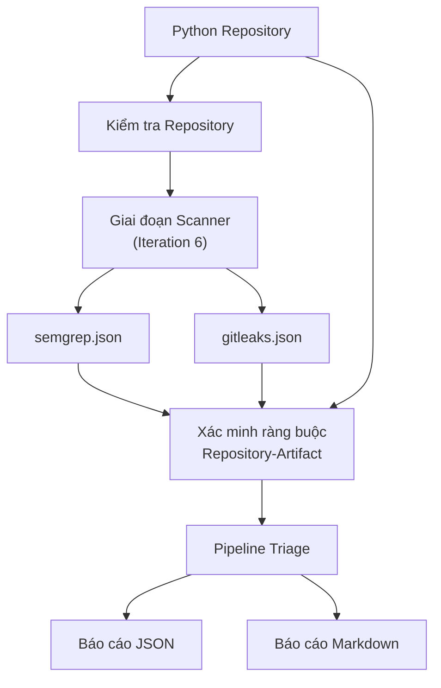
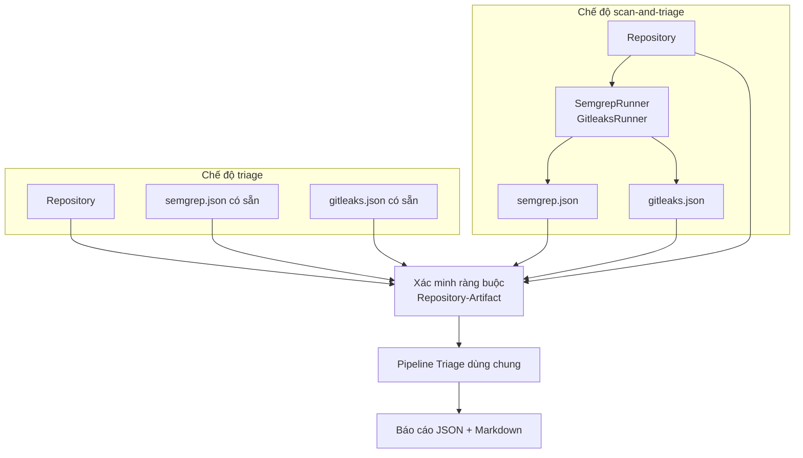
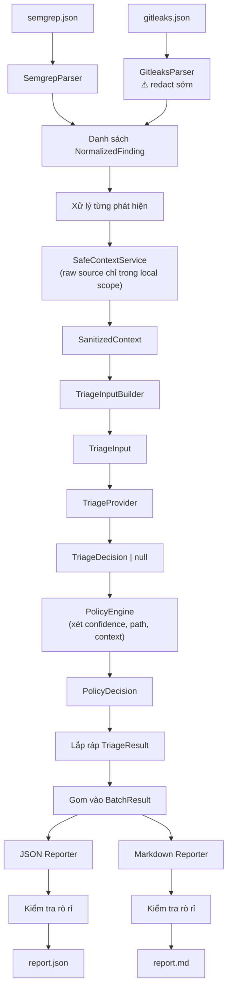

# Kiến trúc

## Đầu vào sản phẩm

Đầu vào sản phẩm là một Python repository cục bộ. Hệ thống quét nó
bằng Semgrep và Gitleaks, rồi phân loại các phát hiện kết quả bằng
ngữ cảnh mã nguồn từ chính repository đó.

Đầu ra JSON của scanner là artifact nội bộ, không phải đầu vào sản
phẩm chính. Chế độ CLI `triage` chấp nhận artifact có sẵn để testing
và sử dụng nâng cao, nhưng luồng công việc chuẩn bắt đầu từ
repository.

## Luồng dữ liệu end-to-end



## Hai chế độ CLI — Một pipeline



Trong chế độ `scan-and-triage`, runner tạo artifact và trạng thái
ràng buộc là `VERIFIED` vì artifact được sinh từ repository trong
cùng lần chạy.

Trong chế độ `triage`, pipeline cố gắng xác minh ràng buộc bằng cách
kiểm tra sự trùng khớp đường dẫn file giữa phát hiện trong artifact
và nội dung repository, đồng thời so sánh metadata commit nếu có.

## Chi tiết pipeline triage

Đây là pipeline dùng chung cho cả hai chế độ CLI.



### SafeContextService — ranh giới raw source

`SafeContextService` là component duy nhất đọc mã nguồn thô từ
repository. Raw source không bao giờ rời khỏi component này.

```
SafeContextService(finding, repo_config) → SanitizedContext

Bên trong (tất cả trong local scope):
1. SafeRepositoryReader đọc source file → biến cục bộ
2. Python context selection:
   - Semgrep: AST → enclosing function/class, fallback line window
   - Gitleaks: line window + AST chỉ cho metadata cấu trúc
3. ContextSanitizer sanitize selected context
4. Kiểm tra rò rỉ phòng thủ sâu
5. Trả SanitizedContext (duy nhất được rời khỏi component)

Raw source bị hủy khi function kết thúc.
```

**Raw source text:**

- Chỉ tồn tại trong local scope của `SafeContextService`.
- Không được serialize.
- Không được log.
- Không được đưa vào exception message.
- Không được lưu trong bất kỳ public Pydantic model nào.
- Không xuất hiện trong `repr` của model public.

### Cách ly lỗi trong vòng lặp

Mỗi phát hiện được xử lý độc lập. Nếu bất kỳ bước nào thất bại cho
một phát hiện:

1. Tạo `ProcessingError` với `safe_message`.
2. `SafeContextService` trả `SanitizedContext` với
   `context_available=False` và `missing_context_reasons` phù hợp.
3. Đặt `triage_decision = null`.
4. Chuyển đến `PolicyAction = TRIAGE_ERROR`.
5. Tiếp tục phát hiện tiếp theo.

Nếu parser của một scanner thất bại hoàn toàn:

1. Ghi `ProcessingError` cấp scanner.
2. Xử lý phát hiện từ scanner còn lại bình thường.
3. Cả hai scanner thất bại tạo `BatchResult` với zero kết quả và
   các bản ghi lỗi.

## Ràng buộc Repository-Artifact

### Bất biến

Các phát hiện từ repository A không bao giờ được triage bằng ngữ cảnh
từ repository B.

### Trạng thái xác minh

`ArtifactRepositoryMatch` cho biết mức độ tin cậy ràng buộc:

| Trạng thái | Ý nghĩa |
|------------|---------|
| `VERIFIED` | Artifact được xác nhận thuộc về repository này. |
| `PARTIAL` | Một số đường dẫn file khớp, một số không. |
| `UNVERIFIED` | Không xác định được ràng buộc. |
| `MISMATCH` | Đường dẫn file hoặc metadata commit mâu thuẫn với repository. |

### Hành vi

- `MISMATCH` → tạo lỗi cấu hình an toàn, dừng pipeline.
- `UNVERIFIED` hoặc `PARTIAL` → ghi trạng thái vào `RunMetadata`,
  tiếp tục với cảnh báo. Policy tự động leo thang lên `MANUAL_REVIEW`.
- `VERIFIED` → tiếp tục bình thường.

## Vòng đời phát hiện Semgrep

```
semgrep.json
│
├─ SemgrepParser
│  ├─ Kiểm tra cấu trúc JSON (mảng results).
│  ├─ Với mỗi result:
│  │   ├─ Ánh xạ: check_id → rule_id, path → file_path,
│  │   │          start.line → start_line, severity → enum Severity.
│  │   ├─ Đặt finding_type = SAST, scanner = SEMGREP.
│  │   └─ Phát ra NormalizedFinding.
│  └─ Khi lỗi từng phát hiện: bỏ qua, phát ra ProcessingError.
│
├─ SafeContextService (raw source chỉ trong local scope)
│  ├─ SafeRepositoryReader:
│  │   ├─ Resolve file_path trong repository (kiểm tra path containment).
│  │   ├─ Đọc file nguồn → biến cục bộ (giới hạn kích thước, kiểm tra encoding).
│  ├─ Python context selection:
│  │   ├─ Parse bằng module ast.
│  │   ├─ Tìm hàm bao quanh → selected_context = function body, strategy = PYTHON_FUNCTION.
│  │   ├─ Tìm class bao quanh → selected_context = class body, strategy = PYTHON_CLASS.
│  │   ├─ AST thất bại hoặc scope quá lớn → strategy = LINE_WINDOW.
│  │   └─ File không đọc được → strategy = UNAVAILABLE (phát hiện không bị loại bỏ).
│  ├─ ContextSanitizer:
│  │   ├─ Quét selected_context tìm mẫu credential (không phải no-op).
│  │   ├─ Redact credential phát hiện được.
│  │   ├─ Cắt ngắn nếu vượt ngân sách.
│  ├─ Kiểm tra rò rỉ phòng thủ sâu.
│  └─ Trả SanitizedContext (raw source bị hủy).
│
├─ TriageInputBuilder
│  ├─ Chọn lọc trường an toàn từ NormalizedFinding.
│  ├─ Gắn SanitizedContext.
│  ├─ Đặt prompt_type = semgrep_triage.
│  └─ Phát ra TriageInput.
│
├─ TriageProvider
│  ├─ Nhận TriageInput (không nhận raw source hay NormalizedFinding trực tiếp).
│  ├─ Xây dựng prompt từ TriageInput.
│  ├─ Gọi LLM (hoặc fake provider).
│  ├─ Validate response theo schema TriageDecision.
│  ├─ Response không hợp lệ → triage_decision = null, ProcessingError.
│  └─ Phát ra TriageDecision | null.
│
├─ PolicyEngine
│  ├─ Nhận NormalizedFinding + TriageDecision + SanitizedContext.
│  ├─ Ánh xạ (ModelVerdict × ModelConfidence × điều kiện) → PolicyAction.
│  ├─ triage_decision = null → TRIAGE_ERROR.
│  └─ Phát ra PolicyDecision.
│
└─ Lắp ráp TriageResult
```

## Vòng đời phát hiện Gitleaks

```
gitleaks.json
│
├─ GitleaksParser
│  ├─ Kiểm tra cấu trúc JSON (mảng đối tượng leak).
│  ├─ Với mỗi leak:
│  │   ├─ Đọc Secret và Match thô TRONG PHẠM VI CỤC BỘ DUY NHẤT.
│  │   ├─ ⚠ REDACT NGAY LẬP TỨC: thay bằng <REDACTED_SECRET>.
│  │   ├─ Bí mật thô không được rời khỏi phạm vi này.
│  │   ├─ Ánh xạ: RuleID → rule_id, File → file_path,
│  │   │          StartLine → start_line.
│  │   ├─ Đặt finding_type = SECRET, scanner = GITLEAKS.
│  │   ├─ Đặt severity = UNKNOWN (scanner không cung cấp severity đáng tin).
│  │   ├─ Lưu secret_category an toàn trong metadata nếu suy ra được.
│  │   └─ Phát ra NormalizedFinding (bí mật đã redact).
│  └─ Khi lỗi: bỏ qua, phát ra ProcessingError.
│
├─ SafeContextService (raw source chỉ trong local scope)
│  ├─ SafeRepositoryReader:
│  │   ├─ Resolve file_path (path containment check).
│  │   ├─ Đọc file nguồn → biến cục bộ.
│  │   ├─ ⚠ File nguồn CÓ THỂ VẪN CHỨA bí mật thô.
│  ├─ Python context selection (Gitleaks-specific):
│  │   ├─ Mặc định: REDACTED_LINE_WINDOW (không gửi toàn function body).
│  │   ├─ AST chỉ dùng để lấy structural metadata:
│  │   │   tên hàm/class bao quanh, decorator.
│  │   ├─ Không trích xuất function body đầy đủ theo mặc định.
│  ├─ ContextSanitizer:
│  │   ├─ ⚠ PHẢI redact lại: ngữ cảnh nguồn chứa bí mật thực.
│  │   ├─ Áp dụng redaction mạnh tại dòng phát hiện và xung quanh.
│  │   ├─ Phát hiện mẫu credential.
│  │   ├─ Cắt ngắn nếu cần.
│  ├─ Kiểm tra rò rỉ phòng thủ sâu.
│  └─ Trả SanitizedContext (không còn bí mật, raw source bị hủy).
│
├─ TriageInputBuilder
│  ├─ Chọn lọc trường an toàn từ NormalizedFinding.
│  ├─ safe_metadata: secret_category, rule_description (KHÔNG: author
│  │   email, commit message, raw match).
│  ├─ Gắn SanitizedContext.
│  ├─ Đặt prompt_type = gitleaks_triage.
│  └─ Phát ra TriageInput.
│
├─ TriageProvider
│  ├─ Nhận TriageInput (không bí mật thô nào đến được LLM).
│  └─ (Giống Semgrep từ đây.)
│
├─ PolicyEngine
│  ├─ Xét thêm: secret_category, path_category.
│  ├─ Protected category (private key, cloud credential, signing key,
│  │   database credential) → luôn bảo thủ.
│  └─ Phát ra PolicyDecision.
│
└─ Lắp ráp TriageResult
```

### Khác biệt chính so với Semgrep

| Khía cạnh | Semgrep | Gitleaks |
|-----------|---------|---------|
| `finding_type` | `SAST` | `SECRET` |
| Redaction parser | Không cần | Redact sớm `Secret` và `Match` trước khi tạo `NormalizedFinding` |
| Rủi ro ngữ cảnh nguồn | Có thể chứa credential ngẫu nhiên | Được biết chứa bí mật đã phát hiện |
| Context strategy mặc định | `PYTHON_FUNCTION` (AST ưu tiên) | `REDACTED_LINE_WINDOW` (AST chỉ cho metadata) |
| Sanitizer | Quét mẫu credential | Redact lại mạnh tại dòng phát hiện |
| Severity mặc định | Ánh xạ từ scanner | `UNKNOWN` |
| Metadata an toàn | `cwe`, `owasp`, `technology` | `secret_category`, `rule_description` |
| Metadata KHÔNG gửi LLM | — | `author` email, `commit` message, raw `match` |
| `prompt_type` | `semgrep_triage` | `gitleaks_triage` |

## Trách nhiệm component

| Component | Sở hữu | Đầu vào | Đầu ra | Không được |
|-----------|--------|---------|--------|------------|
| `SemgrepParser` | Parse JSON semgrep | Đường dẫn file | `List[NormalizedFinding]` | Trích xuất ngữ cảnh, gọi LLM |
| `GitleaksParser` | Parse JSON gitleaks, redact sớm | Đường dẫn file | `List[NormalizedFinding]` (đã redact) | Để bí mật thô rời phạm vi cục bộ |
| `SafeContextService` | Đọc source, chọn scope, sanitize | `NormalizedFinding` + repo config | `SanitizedContext` | Để raw source rời component; trả ContextPackage ra ngoài |
| `TriageInputBuilder` | Đóng gói đầu vào cho provider | `NormalizedFinding` + `SanitizedContext` | `TriageInput` | Bao gồm trường không an toàn (author email, etc.) |
| `TriageProvider` | Gọi LLM để phân loại | `TriageInput` | `TriageDecision \| null` | Nhận NormalizedFinding trực tiếp, raw source, bịa quyết định khi lỗi |
| `PolicyEngine` | Áp dụng chính sách bảo thủ | `NormalizedFinding` + `TriageDecision \| null` + `SanitizedContext` | `PolicyDecision` | Gọi LLM, tự động loại bỏ phát hiện |
| `Pipeline` | Điều phối luồng, cách ly lỗi | Config + artifact paths + repo path | `BatchResult` | Chứa logic nghiệp vụ của parse/triage/policy |
| `ArtifactBinder` | Xác minh ràng buộc repository-artifact | Artifact + repo path | `ArtifactRepositoryMatch` | Âm thầm chấp nhận artifact không khớp |
| `JSONReporter` | Render báo cáo JSON | `BatchResult` | File | Chứa bí mật thô, prompt, traceback, đường dẫn tuyệt đối |
| `MarkdownReporter` | Render báo cáo Markdown | `BatchResult` | File | Chứa bí mật thô, prompt, traceback, đường dẫn tuyệt đối |
| `SemgrepRunner` | Chạy Semgrep (Iter 6) | Repo path + config | `ScannerRunResult` | Dùng `shell=True`, log bí mật |
| `GitleaksRunner` | Chạy Gitleaks (Iter 6) | Repo path + config | `ScannerRunResult` | Dùng `shell=True`, log bí mật |

## Hợp đồng Scanner Runner (Iteration 6)

Scanner runner phải:

1. Kiểm tra scanner executable tồn tại trước khi gọi.
2. Ghi lại phiên bản scanner trong `ScannerRunResult`.
3. Chấp nhận timeout cấu hình được.
4. Gọi scanner qua `subprocess` không có `shell=True`.
5. Không ghép đầu vào người dùng thành chuỗi lệnh shell.
6. Bắt exit code an toàn.
7. Phân biệt exit code có finding với lỗi thực thi.
8. Lưu artifact scanner thô vào thư mục đầu ra có kiểm soát.
9. Không log nội dung stdout/stderr nếu có thể chứa bí mật.
10. Trả `ScannerRunResult` với: status, version, đường dẫn artifact,
    thời lượng, và thông báo lỗi an toàn.

Cấu hình scanner phải rõ ràng. `--config auto` cho Semgrep chỉ chấp
nhận được làm tùy chọn demo, không phải mặc định sản xuất. Định danh
cấu hình phải xuất hiện trong `RunMetadata`.

## Cấu trúc thư mục

### Kiến trúc mục tiêu (Chỉ để tham khảo)

```
src/sast_triage/
├── __init__.py
├── __main__.py                   # Iteration 5
├── cli.py                        # Iteration 5
├── pipeline.py                   # Iteration 4
├── models.py                     # Iteration 1
├── errors.py                     # Iteration 1
├── config.py                     # Iteration 4
├── parsers/
│   ├── __init__.py               # Iteration 2
│   ├── base.py                   # Iteration 2
│   ├── semgrep.py                # Iteration 2
│   └── gitleaks.py               # Iteration 2
├── context/
│   ├── __init__.py               # Iteration 3
│   ├── service.py                # Iteration 3 — SafeContextService (public API)
│   ├── reader.py                 # Iteration 3 — SafeRepositoryReader (internal)
│   ├── python_extractor.py       # Iteration 3 — Python AST extraction (internal)
│   └── sanitizer.py              # Iteration 3 — ContextSanitizer (internal)
├── triage/
│   ├── __init__.py               # Iteration 4
│   ├── base.py                   # Iteration 4
│   ├── input_builder.py          # Iteration 4 — TriageInputBuilder
│   ├── fake_provider.py          # Iteration 4
│   ├── llm_provider.py           # Iteration 7
│   └── prompt.py                 # Iteration 4
├── policy/
│   ├── __init__.py               # Iteration 4
│   └── engine.py                 # Iteration 4
├── runners/
│   ├── __init__.py               # Iteration 6
│   ├── base.py                   # Iteration 6
│   ├── semgrep_runner.py         # Iteration 6
│   └── gitleaks_runner.py        # Iteration 6
├── reporting/
│   ├── __init__.py               # Iteration 5
│   ├── json_report.py            # Iteration 5
│   └── markdown_report.py        # Iteration 5
└── binding.py                    # Iteration 4

tests/
├── __init__.py
├── conftest.py
├── fixtures/
│   ├── semgrep_valid.json
│   ├── semgrep_malformed.json
│   ├── gitleaks_valid.json
│   ├── gitleaks_malformed.json
│   └── sample_repo/
│       ├── app.py
│       └── config.py
├── test_models.py                # Iteration 1
├── test_parsers/                 # Iteration 2
├── test_context/                 # Iteration 3
├── test_triage/                  # Iteration 4
├── test_policy.py                # Iteration 4
├── test_pipeline.py              # Iteration 4
├── test_reporting/               # Iteration 5
├── test_cli.py                   # Iteration 5
├── test_runners/                 # Iteration 6
└── test_e2e.py                   # Iteration 5
```

### Cấu trúc Iteration 1 (Tối đa)

```
pyproject.toml
src/sast_triage/__init__.py
src/sast_triage/models.py
src/sast_triage/errors.py
tests/test_models.py
```

Không cho phép file nguồn nào khác trong Iteration 1.
