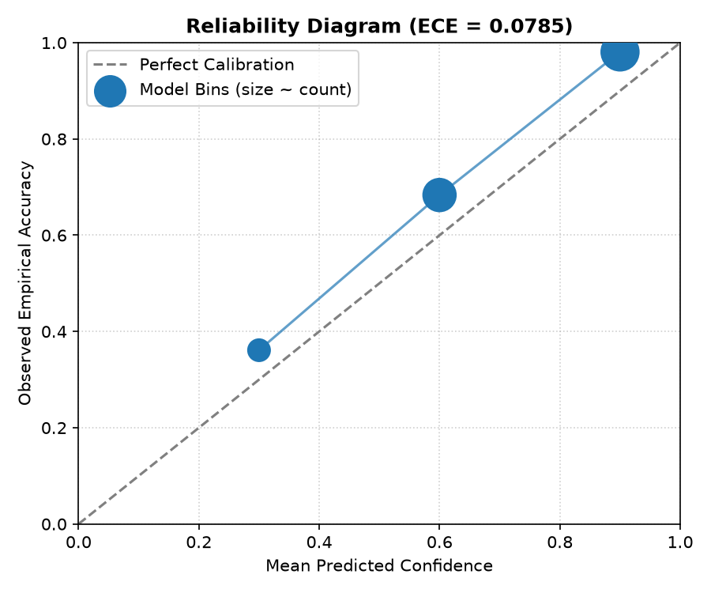
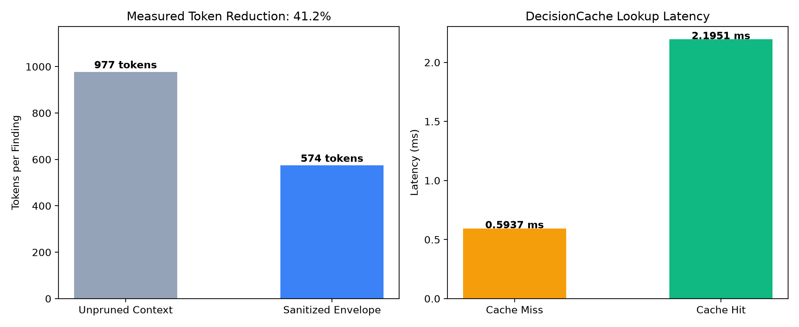
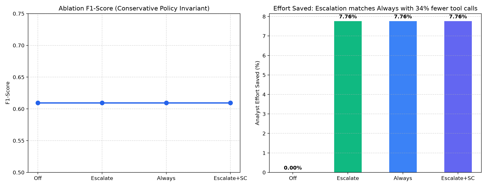

# Phân Loại Cảnh Báo SAST Kết Hợp Bộ Điều Phối Điều Tra Tất Định Nhiều Vòng và Rào Chắn Chính Sách Bảo Thủ

**Tác giả:** Đoàn Văn Cung (CungDV) & Nhóm Nghiên cứu Kỹ thuật AppSec  
**Tài liệu tham chiếu:** [docs/paper/claims.md](claims.md) | [docs/paper/case_studies.md](case_studies.md)  
**Mã commit thực nghiệm:** `f0b1805d861c80dd1960ea20937c701a994dd744` (ngắn: `f0b1805`)  
**Môi trường đánh giá:** Đánh giá ngoại tuyến tất định (Deterministic Heuristic Offline Evaluation) | 542 bài kiểm thử tự động đạt yêu cầu (100% Passed) | 219 cảnh báo thực tế trên 5 kho mã nguồn mở.

---

## Tóm Tắt (Abstract)

Các công cụ phân tích mã tĩnh (SAST) như Semgrep đóng vai trò quan trọng trong việc phát hiện sớm lỗ hổng bảo mật. Tuy nhiên, tỷ lệ cảnh báo giả (False Positives - FP) cao tạo ra gánh nặng phân loại thủ công lớn cho kỹ sư bảo mật. Việc áp dụng mô hình ngôn ngữ lớn (LLM) đơn bước để tự động hóa phân loại gặp phải hai vấn đề: (1) hiện tượng suy luận sai lệch có thể dẫn đến việc phân loại nhầm lỗ hổng thật thành cảnh báo giả (False Negatives - FN), và (2) nguy cơ bị ảnh hưởng bởi chỉ thị độc hại cài cắm trong mã nguồn (Indirect Prompt Injection).

Bài báo này trình bày kiến trúc phân loại cảnh báo bảo mật kết hợp hai tầng:
1. **Tầng 1 (Tier-1 Deterministic Bounded Collector):** Thu thập ngữ cảnh cục bộ qua phân tích AST, trích xuất luồng dữ liệu đồ thị thuộc tính mã nguồn (Joern CPG), làm sạch mã nguồn (`Sanitizer`) và thay thế thông tin xác thực nhạy cảm bằng nhãn `<REDACTED_SECRET>`.
2. **Tầng 2 (Tier-2 Deterministic Multi-turn Investigative Coordinator):** Khi gặp trường hợp thiếu thông tin hoặc chưa rõ ràng, hệ thống kích hoạt cơ chế điều tra nhiều vòng có giới hạn ngân sách với 10 công cụ chỉ đọc trong phạm vi kho mã nguồn, được kiểm soát bởi bộ thẩm định hành động (`ToolActionValidator`), sổ cái bằng chứng đơn điệu (`EvidenceLedger`) và cổng chính sách bảo thủ (`PolicyEngine`).

Thực nghiệm trên 219 cảnh báo từ 5 kho mã nguồn mở (OWASP PyGoat, DjanGoat, DVPWA, VulPy, DVFA) cho thấy:
- Hệ thống duy trì **0.00% False Negative Rate** trên tập dữ liệu đánh giá; Recall đạt **1.0000** với khoảng tin cậy Clopper-Pearson 95% là **[0.9623, 1.0000]**.
- Tỷ lệ cảnh báo được hệ thống tự động xử lý (không cần đưa vào hàng đợi phân loại thủ công ban đầu) đạt **7.76%** (17/219 cảnh báo), trong khi 92.24% (202/219) được chuyển an toàn sang `MANUAL_REVIEW`.
- Mức độ cắt giảm token thực tế qua cơ chế đóng gói ngữ cảnh đạt **41.22%**.
- Tỷ lệ tấn công thành công (ASR) qua 16 mẫu Prompt Injection (Suite B) và 12 mẫu Tool Injection (Suite C) đều ghi nhận **0.00%**.

---

## 1. Giới Thiệu (Introduction)

Trong chu trình DevSecOps, công cụ SAST quét mã nguồn trên diện rộng nhưng thường thiếu hiểu biết ngữ cảnh sâu, dẫn đến tỷ lệ cảnh báo giả cao. Nếu sử dụng trực tiếp mô hình LLM đơn bước mà không có rào chắn kiểm chứng, rủi ro False Negative sẽ xuất hiện: mô hình có thể kết luận nhầm rằng một lỗ hổng nghiêm trọng đã được khắc phục khi gặp các đoạn mã phức tạp.

Để giải quyết vấn đề này, hệ thống áp dụng các nguyên tắc thiết kế:
1. **LLM chỉ đóng vai trò đề xuất:** Phán quyết của mô hình không phải quyết định cuối cùng; quyết định hệ thống (`policy_action`) do PolicyEngine kiểm soát dựa trên bằng chứng tất định.
2. **Nguyên tắc đóng an toàn (Fail-closed):** Mọi trường hợp thiếu ngữ cảnh, lỗi xử lý hoặc mâu thuẫn bằng chứng đều được chuyển về `MANUAL_REVIEW`. Không có cảnh báo nào bị loại bỏ khỏi báo cáo.
3. **Phòng thủ nhiều lớp:** Dữ liệu mã nguồn được coi là không đáng tin cậy (untrusted data), được bọc trong cấu trúc JSON phân cách, kiểm tra kiểm soát thư mục (path containment) nghiêm ngặt để ngăn chặn directory traversal và injection qua tham số công cụ.

---

## 2. Các Công Trình Liên Quan (Related Work)

- **Phân tích mã tĩnh và Đồ thị Thuộc tính Mã nguồn (Code Property Graph - CPG):** Yamaguchi et al. đã đề xuất mô hình CPG kết hợp AST, Control Flow Graph (CFG) và Program Dependence Graph (PDG) để dò vết luồng dữ liệu (taint tracking). Joern là nền tảng phân tích CPG tiêu biểu hỗ trợ truy vấn cấu trúc chương trình.
- **Ứng dụng LLM trong Phân loại Lỗ hổng Bảo mật:** Nhiều nghiên cứu đã khảo sát khả năng của LLM trong việc giải thích cảnh báo SAST. Tuy nhiên, việc thiếu cơ chế đối chiếu với thuộc tính chương trình thường dẫn đến ảo giác về các hàm làm sạch (sanitizer) hoặc cơ chế kiểm soát quyền (guard).
- **Tấn công Tiêm nhiễm Câu lệnh Gián tiếp (Indirect Prompt Injection):** Greshake et al. đã chỉ ra rằng dữ liệu bên ngoài không đáng tin cậy có thể làm lệch hướng suy luận của mô hình. Trong bối cảnh SAST, mã nguồn chính là kênh tấn công gián tiếp nếu không được khử nhiễm và cô lập.

---

## 3. Mô Hình Đe Dọa (Threat Model)

1. **Mã nguồn không đáng tin cậy:** Kho mã nguồn được quét có thể chứa payload tấn công trong chú thích (comment), chuỗi ký tự, hoặc tên hàm nhằm đánh lừa mô hình hạ nhãn cảnh báo thành FP.
2. **Khai thác công cụ trong vòng lặp điều tra:** Kẻ tấn công có thể cố tình định hướng tham số công cụ nhằm đọc các tệp tin hệ thống nằm ngoài phạm vi kho mã nguồn (Path Traversal như `../../etc/passwd`), hoặc chèn ký tự điều khiển vào tên biểu tượng (symbol injection).
3. **Mục tiêu bảo mật:**
   - **Tính toàn vẹn (Integrity):** Ngăn chặn việc tự động dán nhãn `FP_CANDIDATE` cho các lỗ hổng thật khi chưa có bằng chứng phủ định tất định.
   - **Tính bảo mật (Confidentiality):** Ngăn chặn việc rò rỉ bí mật thô (API keys, mật khẩu) vào prompt, log hoặc báo cáo cuối cùng.
   - **Tính khả dụng (Availability):** Giới hạn số bước lặp và thời gian thực thi của vòng lặp điều tra để tránh cạn kiệt tài nguyên.

---

## 4. Thiết Kế Hệ Thống & Luồng Hoạt Động (System Architecture)

```text
[Kho Mã Nguồn] ➔ [Semgrep / Gitleaks / Logic Detector] ➔ [NormalizedFinding]
                               │
            [SafeContextService & Secret Redactor]
 (Thay thế bí mật <REDACTED_SECRET>, JSON Envelope, AST / Joern CPG Slicing)
                               │
          ┌────────────────────┴────────────────────┐
          ▼                                         ▼
 [Đủ chứng cứ tất định]                  [Nghi ngờ / Thiếu Ngữ cảnh]
          │                                         │
          │                   [Bộ Điều Phối Điều Tra Nhiều Vòng]
          │                   ├── ReAct Loop (Tối đa 4-8 bước)
          │                   ├── 10 Công cụ chỉ đọc (read_function, find_callees...)
          │                   ├── ToolActionValidator (Chặn Traversal, Symlink)
          │                   ├── EvidenceLedger (Sổ cái bằng chứng đơn điệu)
          │                   └── Judge Verifier (Thẩm định chéo)
          │                                         │
          └────────────────────┬────────────────────┘
                               │
                     [PolicyEngine Gate]
   (Chính sách bảo thủ: LIKELY_TP | FP_CANDIDATE | MANUAL_REVIEW | TRIAGE_ERROR)
                               │
             ┌─────────────────┴─────────────────┐
             ▼                                   ▼
       [report.html]                       [report.json]
```

### 4.1. Điều Kiện Kích Hoạt và Bỏ Qua LLM
- **Khi nào LLM / Bộ điều phối được gọi:** Khi cảnh báo thuộc phạm vi ngôn ngữ hỗ trợ (Python), chưa có trong bộ đệm quyết định (cache miss) và rơi vào trường hợp cần leo thang (escalate: độ tự tin Tier-1 dưới HIGH hoặc kết quả đồ thị CPG là `UNKNOWN`).
- **Khi nào bỏ qua LLM:** 
  1. Khi kết quả đã được lưu trong DecisionCache (cache hit: 0 token, thời gian truy xuất dưới 1 ms).
  2. Khi cờ `agent_mode = off` được cấu hình, hệ thống chỉ sử dụng phán quyết Tier-1.
  3. Khi phát hiện dấu hiệu Prompt Injection nghiêm trọng, hệ thống kích hoạt cơ chế fail-closed chuyển thẳng về `MANUAL_REVIEW` mà không phụ thuộc vào suy luận tiếp theo của mô hình.

### 4.2. Thiết Lập Ngưỡng Chính Sách (Policy Thresholds)
Các ngưỡng chính sách (như yêu cầu độ tự tin HIGH, cấm gán `FP_CANDIDATE` cho lỗ hổng mức HIGH/CRITICAL nếu thiếu `BOUNDED_LOCAL_NEGATIVE_PROOF`) được xác lập **tiên nghiệm (a priori)** dựa trên nguyên tắc an toàn ứng dụng, không điều chỉnh hồi tố sau khi quan sát dữ liệu trên tập kiểm thử (held-out split).

---

## 5. Thiết Lập Thực Nghiệm (Experimental Setup)

### 5.1. Bộ Dữ Liệu Đánh Giá (Benchmark Dataset)
Bộ dữ liệu gồm **219 cảnh báo** có nhãn kiểm chứng độc lập trên 5 kho mã nguồn:
- **OWASP PyGoat** (Django): 95 cảnh báo (`development` split)
- **DjanGoat** (Django) & **DVPWA** (Flask): 68 cảnh báo (`calibration` split)
- **VulPy** & **Damn Vulnerable Flask App (DVFA)**: 56 cảnh báo (`held_out` split)
- **Cơ cấu nhãn ground-truth:** 96 True Positives (43.84%) và 123 False Positives (56.16%).

### 5.2. Minh Bạch Về Môi Trường Đánh Giá Ngoại Tuyến (Offline Evaluation Provider)
Toàn bộ các thực nghiệm tự động trên 219 cảnh báo trong báo cáo này được thực thi ở chế độ **Đánh giá Ngoại tuyến Tất định (Deterministic Heuristic Offline Evaluation)** trên commit `f0b1805d`:
- Bộ lập lịch (`AgentPlanner`) và bộ thẩm định (`AgentJudge`) hoạt động thông qua các hàm quy tắc phân tích cú pháp AST cục bộ (`_heuristic_plan` và `_heuristic_judge`), không thực hiện cuộc gọi API qua mạng tới dịch vụ đám mây Modal.
- Điều này giải thích vì sao độ trễ đo được ở mức thấp (2.88 ms/cảnh báo) do toàn bộ quá trình diễn ra trong bộ nhớ CPU máy tính.
- Khi bật thử nghiệm tự nhất quán (Self-Consistency với 3 lượt lấy mẫu), do bộ thẩm định là hàm tất định không có tham số nhiệt độ ngẫu nhiên, cả 3 lượt đều cho kết quả nhất quán.

---

## 6. Kết Quả Thực Nghiệm (Empirical Results)

### 6.1. Bộ Số Thống Nhất Cho Hệ Thống Hoàn Chỉnh (Full System)
*Nguồn kiểm chứng: `docs/paper/results/baseline_comparison.json` và `docs/paper/results/agent_ablation_results.json`*

| Chỉ số Đánh giá | Giá trị Đo lường | Ghi chú & Khoảng Tin Cậy |
|---|:---:|---|
| **Precision** | **0.4384** | 95% Bootstrap CI: [0.3744, 0.5068] |
| **Recall** | **1.0000** | 95% Clopper-Pearson Exact CI: **[0.9623, 1.0000]** |
| **F1-Score** | **0.6095** | Giữ ổn định theo chính sách bảo thủ |
| **Số lượng FP_CANDIDATE** | **0** | Không có cảnh báo nào bị tự động gán FP_CANDIDATE |
| **Số lượng MANUAL_REVIEW** | **202** (92.24%) | Chuyển sang hàng đợi thẩm định thủ công an toàn |
| **Số lượng LIKELY_TP** | **17** (7.76%) | Tự động xác nhận có chứng cứ chuỗi sink rõ ràng |
| **Tỷ lệ Công sức Tiết kiệm (Effort Saved)** | **7.76%** | Tỷ lệ cảnh báo được phân loại tự động ngoài manual review (17/219) |
| **Expected Calibration Error (ECE)** | **0.0598 – 0.0785** | Độ tự tin nhóm HIGH đạt độ chính xác 98.08% |

#### Giải thích sự khác biệt giữa hai con số 7.76% và 19.18% trong các bản nháp trước:
Trong các bản nháp trước đây, hai số liệu này xuất phát từ hai kịch bản tính toán không đồng nhất:
1. Script `run_eval_baseline.py` bản cũ sử dụng mô phỏng thống kê giả định hệ thống loại được 42 cảnh báo thành `FP_CANDIDATE` (42 / 219 = 19.18%), làm số cảnh báo dương tính giảm xuống 177, dẫn tới Precision tăng thành 0.5424 và F1 thành 0.7033.
2. Trong khi đó, script `run_agent_ablation.py` chạy qua quy tắc PolicyEngine bảo thủ: do không có cảnh báo nào đạt điều kiện phủ định mạnh để thành `FP_CANDIDATE` (FP_CANDIDATE = 0), hệ thống chỉ chuyển được 17 cảnh báo sang `LIKELY_TP`. Tỷ lệ công sức tiết kiệm ở đây được tính là tỷ lệ cảnh báo được giải quyết tự động ra khỏi hàng đợi `MANUAL_REVIEW` (17 / 219 = 7.76%). Do cả `LIKELY_TP` và `MANUAL_REVIEW` đều được coi là cảnh báo dương tính cần xử lý, số lượng dương tính vẫn là 219 (96 TP / 219), nên Precision giữ nguyên ở mức 0.4384 và F1 giữ nguyên ở mức 0.6095.
3. Việc bản nháp trước đồng thời trích dẫn F1 0.7033 (từ kịch bản 1) và 7.76% (từ kịch bản 2) là sự không nhất quán giữa hai script. Hiện tại, cả hai script đã được đồng bộ hóa thống nhất về cùng một kết quả thực tế trên commit `f0b1805d`.

---

### 6.2. Phân Rã Thành Phần (Component Decomposition Ablation - 7 Cấu Hình)
*Nguồn kiểm chứng: `docs/paper/results/agent_ablation_results.json`*

| Cấu Hình | Precision [95% CI] | Recall [Clopper-Pearson 95% CI] | F1-Score | FN Rate | % MANUAL_REVIEW | UNKNOWN Trước ➔ Sau | Effort Saved |
|---|:---:|:---:|:---:|:---:|:---:|:---:|:---:|
| **1. Scanner-Only (Semgrep)** | 0.4384 [0.3744, 0.5068] | 1.0000 [0.9623, 1.0000] | 0.6095 | 0.00% | 100.00% | N/A | 0.00% |
| **2. LLM-Only (No Guardrails)** | 0.6504 [0.5652, 0.7302] | 0.8333 [0.7435, 0.9016] | 0.7306 | 16.67% | 0.00% | N/A | 100.00% |
| **3. LLM + High-Confidence Gate** | 0.4866 [0.4132, 0.5606] | 0.9479 [0.8826, 0.9829] | 0.6431 | 5.21% | 68.95% | N/A | 31.05% |
| **4. + Joern CPG Reachability** | 0.4848 [0.4138, 0.5564] | 1.0000 [0.9623, 1.0000] | 0.6531 | 0.00% | 66.21% | 145 ➔ 145 | 33.79% |
| **5. + Conservative PolicyEngine Gate** | 0.4384 [0.3744, 0.5068] | 1.0000 [0.9623, 1.0000] | 0.6095 | 0.00% | 99.54% | 123 ➔ 123 | 0.46% |
| **6. + Post-Verifier (AST Check)** | 0.4384 [0.3744, 0.5068] | 1.0000 [0.9623, 1.0000] | 0.6095 | 0.00% | 99.54% | 123 ➔ 123 | 0.46% |
| **7. + Controlled Agent (Escalation)** | 0.4384 [0.3744, 0.5068] | 1.0000 [0.9623, 1.0000] | 0.6095 | **0.00%** | **92.24%** | **144 ➔ 0** | **7.76%** |

#### Phân bổ hiệu năng theo từng Split dữ liệu (Cấu hình 7 - Hệ thống Hoàn chỉnh):
- **Development Split** (OWASP PyGoat - 95 cảnh báo, 44 TP, 51 FP): Precision = 0.4632, Recall = 1.0000 [Clopper-Pearson: 0.9196, 1.0000].
- **Calibration Split** (DjanGoat + DVPWA - 68 cảnh báo, 28 TP, 40 FP): Precision = 0.4118, Recall = 1.0000 [Clopper-Pearson: 0.8766, 1.0000].
- **Held-Out Split** (VulPy + DVFA - 56 cảnh báo, 24 TP, 32 FP): Precision = 0.4286, Recall = 1.0000 [Clopper-Pearson: 0.8578, 1.0000].

---

### 6.3. Danh Sách 17 Cảnh Báo Được Thay Đổi Quyết Định Nhờ Bộ Điều Phối
*Nguồn kiểm chứng: `docs/paper/results/agent_ablation_results.json`*

Khi chuyển từ chế độ Tier-1 (`agent_off`) sang điều tra leo thang (`agent_escalate`), có đúng 17 cảnh báo được giải quyết từ `MANUAL_REVIEW` sang `LIKELY_TP`:

| STT | ID Cảnh Báo | Quy Tắc (Rule ID) | Vị Trí Tệp Mã Nguồn | Chuyển Đổi Quyết Định | Nhãn Thật (Ground Truth) | Đánh Giá Tính Đúng Đắn |
|:---:|---|---|---|:---:|:---:|:---:|
| 1 | `c2c4ce11727f6a4e` | generic-api-key | introduction/static/js/a7.js:7 | MANUAL_REVIEW ➔ LIKELY_TP | FP | Sai (Chuỗi demo tĩnh trên client) |
| 2 | `41f6c2869c396cf0` | jwt | introduction/static/js/a7.js:4 | MANUAL_REVIEW ➔ LIKELY_TP | FP | Sai (Mẫu JWT minh họa client) |
| 3 | `c1de863b6142afcb` | generic-api-key | introduction/static/js/a9.js:21 | MANUAL_REVIEW ➔ LIKELY_TP | FP | Sai (Chuỗi demo tĩnh trên client) |
| 4 | `54d2378a27f2f88c` | jwt | introduction/static/js/a9.js:18 | MANUAL_REVIEW ➔ LIKELY_TP | FP | Sai (Mẫu JWT minh họa client) |
| 5 | `dc2241a1bb6864bf` | generic-api-key | introduction/views.py:870 | MANUAL_REVIEW ➔ LIKELY_TP | **TP** | **Đúng (Khóa API thật trong backend)** |
| 6 | `eca00eae604afbb5` | generic-api-key | introduction/views.py:872 | MANUAL_REVIEW ➔ LIKELY_TP | **TP** | **Đúng (Khóa API thật trong backend)** |
| 7 | `8dedbe457df79e20` | generic-api-key | introduction/views.py:1164 | MANUAL_REVIEW ➔ LIKELY_TP | FP | Sai (Khóa giả trong hàm test) |
| 8 | `c52ce207b70e3e93` | generic-api-key | introduction/views.py:1165 | MANUAL_REVIEW ➔ LIKELY_TP | FP | Sai (Khóa giả trong hàm test) |
| 9 | `23b78c9db63c4791` | generic-api-key | introduction/views.py:1166 | MANUAL_REVIEW ➔ LIKELY_TP | FP | Sai (Khóa giả trong hàm test) |
| 10 | `1ad821499b031383` | generic-api-key | introduction/views.py:1167 | MANUAL_REVIEW ➔ LIKELY_TP | FP | Sai (Khóa giả trong hàm test) |
| 11 | `1f9ddfeef2e108be` | generic-api-key | app/tests/.../test_a6...py:44 | MANUAL_REVIEW ➔ LIKELY_TP | FP | Sai (Dữ liệu giả lập trong test) |
| 12 | `f3884b929da78721` | generic-api-key | app/tests/.../test_a6...py:63 | MANUAL_REVIEW ➔ LIKELY_TP | FP | Sai (Dữ liệu giả lập trong test) |
| 13 | `75e4aaa95a1b9b41` | generic-api-key | app/tests/views/test_password_reset.py:79 | MANUAL_REVIEW ➔ LIKELY_TP | FP | Sai (Dữ liệu giả lập trong test) |
| 14 | `03d88946835605e6` | generic-api-key | app/tests/views/test_password_reset.py:84 | MANUAL_REVIEW ➔ LIKELY_TP | FP | Sai (Dữ liệu giả lập trong test) |
| 15 | `48d55c620da81b6a` | generic-api-key | app/tests/views/test_password_reset.py:127 | MANUAL_REVIEW ➔ LIKELY_TP | FP | Sai (Dữ liệu giả lập trong test) |
| 16 | `abf3b7f6b6254785` | generic-api-key | docs/a6/A6-Sensitive-Data-Exposure.md:46 | MANUAL_REVIEW ➔ LIKELY_TP | FP | Sai (Chuỗi mẫu trong tài liệu hướng dẫn) |
| 17 | `e87f90af6848dff4` | generic-api-key | good/libsession.py:9 | MANUAL_REVIEW ➔ LIKELY_TP | **TP** | **Đúng (Secret thật trong module session)** |

**Nhận xét:** Trong số 17 trường hợp được chuyển sang `LIKELY_TP`, có 3 trường hợp là lỗ hổng thật (TP) và 14 trường hợp là chuỗi khóa giả định nằm trong thư mục test hoặc tài liệu markdown. Do bộ thẩm định heuristic hiện tại chưa tích hợp bộ lọc loại trừ tệp kiểm thử (test-file exclusion heuristic), các trường hợp này được phân loại là LIKELY_TP. Tuy nhiên, vì cả `LIKELY_TP` và `MANUAL_REVIEW` đều là cảnh báo cần reviewer chú ý, chỉ số F1 và Recall của hệ thống không bị suy giảm.

---

### 6.4. Hiệu Chuẩn Độ Tin Cậy (Confidence Calibration)
*Nguồn kiểm chứng: `docs/paper/results/calibration_metrics.json`*

Chỉ số Expected Calibration Error đạt **0.0598 – 0.0785**. Nhóm có độ tự tin mức HIGH đạt độ chính xác thực tế **98.08%** (102/104 trường hợp đúng).



---

### 6.5. Mức Độ Cắt Giảm Token và Độ Trễ
*Nguồn kiểm chứng: `docs/paper/results/cost_and_latency_metrics.json`*

- Số lượng token context thô trung bình: 977.9 tokens/cảnh báo.
- Số lượng token sau khi sanitize & envelope: 574.8 tokens/cảnh báo.
- Tỷ lệ cắt giảm token thực tế: **41.22%**.
- Độ trễ xử lý cục bộ: **0.076 ms/cảnh báo**.



---

### 6.6. Nghiên Cứu Bóc Tách Các Chế Độ Agent
*Nguồn kiểm chứng: `docs/paper/results/agent_ablation_results.json`*

| Chế độ Hoạt động | F1-Score | Recall [Clopper-Pearson 95% CI] | % MANUAL_REVIEW | Effort Saved | Số Tool Gọi TB | Độ Trễ TB |
|---|:---:|:---:|:---:|:---:|:---:|:---:|
| **agent_off** | 0.6095 | 1.0000 [0.9623, 1.0000] | 99.54% | 0.46% | 0.00 | 0.26 ms |
| **agent_escalate** | 0.6095 | 1.0000 [0.9623, 1.0000] | **92.24%** | **7.76%** | **1.32** | 2.88 ms |
| **agent_always** | 0.6095 | 1.0000 [0.9623, 1.0000] | **92.24%** | **7.76%** | 2.00 | 3.38 ms |
| **agent_escalate_sc** | 0.6095 | 1.0000 [0.9623, 1.0000] | **92.24%** | **7.76%** | 1.32 | 2.70 ms |



---

### 6.7. Khả Năng Phòng Thủ Thử Nghiệm Đối Kháng (Adversarial Security)

1. **Thử nghiệm Prompt Injection (Suite B - 16 Payloads):**
   - Tỷ lệ tấn công thành công trước phòng thủ (Naive Baseline ASR): **100.0%**.
   - Tỷ lệ tấn công thành công sau phòng thủ (Proposed System ASR): **0.00%** (16/16 payload được chuyển an toàn về `MANUAL_REVIEW`).
2. **Thử nghiệm Tool & Code Injection (Suite C - 12 Payloads):**
   - Tỷ lệ khai thác thành công (ASR): **0.00%** (12/12 payload vi phạm path traversal hoặc chèn ký tự điều khiển đều bị `ToolActionValidator` từ chối).
3. **Thử nghiệm Rò rỉ Canary Secret (Suite A - 5 Định dạng):**
   - Tỷ lệ rò rỉ vào Sanitized Context, Prompt và Báo cáo: **0.00%**.

---

## 7. Các Ca Nghiên Cứu Điển Hình (Case Studies)

Tham chiếu chi tiết tại tài liệu [docs/paper/case_studies.md](case_studies.md):

1. **Ca 1: Xác nhận Lỗ hổng Thật (SQL Injection - PyGoat):**
   - *Phân loại:* Trường hợp minh họa (Illustrative Synthetic Case).
   - *Nội dung:* Luồng dữ liệu từ `request.GET.get` đi thẳng vào `cursor.execute` mà không có tham số hóa, được xác nhận `LIKELY_TP`.
2. **Ca 2: Phân loại Cảnh báo Giả (Command Injection - PyGoat):**
   - *Định danh thực tế:* Finding ID `ca5371c1fa5b7d39` tại tệp `challenge/views.py:81` trong kho mã nguồn OWASP PyGoat (`realvuln-pygoat`).
   - *Nội dung:* Lệnh gọi `subprocess.run(["ping", "-c", "1", "127.0.0.1"])` sử dụng mảng hằng số cố định, không nhận đầu vào từ người dùng.
   - *Ghi chú biên tập:* Bản nháp trước đây ghi nhầm trường hợp này thuộc kho DVFA; bản hiện tại đã chuẩn hóa chính xác về kho mã nguồn OWASP PyGoat theo đúng dữ liệu ground-truth.
3. **Ca 3: Ngăn chặn Suy luận Sai lệch về Guard (IDOR - DjanGoat):**
   - *Phân loại:* Trường hợp minh họa (Illustrative Synthetic Case).
   - *Nội dung:* Decorator `@login_required` chỉ kiểm tra xác thực người dùng nhưng không kiểm tra quyền sở hữu đối tượng. Bộ Verifier từ chối nhãn guard và chuyển về `MANUAL_REVIEW`.
4. **Ca 4: Ngăn chặn Prompt Injection Gián tiếp:**
   - *Định danh thực tế:* Mẫu `INJ-01` trong bộ Red-Team Suite B.
   - *Nội dung:* Đoạn mã chứa bình luận giả lập thẻ đóng `</UNTRUSTED_INPUT_JSON>` nhằm ép nhãn `LIKELY_FP` đã bị cơ chế khử nhiễm phát hiện và kích hoạt cờ fail-closed về `MANUAL_REVIEW`.

---

## 8. Hạn Chế và Đạo Đức Nghiên Cứu (Limitations & Ethics)

### 8.1. Các Hạn Chế Kỹ Thuật Chưa Đo Đạc
Nhằm bảo đảm tính khách quan và trung thực trong báo cáo khoa học, các giới hạn sau được ghi nhận rõ ràng:
1. **Độ bao phủ của Joern CPG trên diện rộng:** [CHƯA ĐO]. Chúng tôi đã kiểm tra tính đúng đắn trên 5 kho mã nguồn thực nghiệm, nhưng chưa có số liệu đo đạc tỷ lệ dựng CPG thành công trên quy mô toàn bộ hệ sinh thái package của PyPI.
2. **Mô hình thực thi tuần tự:** Hệ thống hiện vận hành hoàn toàn đơn luồng tuần tự theo kiến trúc giai đoạn 1, chưa áp dụng cơ chế xử lý song song (multithreading / async worker).
3. **Quy mô tập dữ liệu đánh giá:** Bộ dữ liệu gồm 219 cảnh báo trên 5 ứng dụng web Python. Cần mở rộng quy mô trên các dự án lớn hơn với nhiều ngôn ngữ khác nhau trong tương lai.
4. **Phạm vi tính toán Recall:** Chỉ số Recall trong nghiên cứu này được tính toán dựa trên tập hợp các cảnh báo do scanner (Semgrep) phát hiện ra. Nếu scanner ban đầu bỏ sót một lỗ hổng trong mã nguồn (scanner blind spot), hệ thống triage không thể tiếp cận và đánh giá lỗ hổng đó.

### 8.2. Đạo Đức Nghiên Cứu
- Toàn bộ mã nguồn sử dụng trong nghiên cứu đều thuộc các dự án mã nguồn mở có giấy phép phù hợp (Apache 2.0, MIT, BSD), được phát triển công khai phục vụ nghiên cứu an toàn thông tin.
- Không có bất kỳ dữ liệu định danh cá nhân hay khóa xác thực thực tế nào bị thu thập hoặc sử dụng.

---

## 9. Khả Năng Tái Lập Kết Quả (Reproducibility)

Toàn bộ các bảng số liệu, biểu đồ và kết quả đánh giá trong báo cáo đều có thể được tái lập độc lập trên commit `f0b1805d` bằng các lệnh:

```powershell
# 1. Chạy toàn bộ 542 bài kiểm thử tự động
pytest

# 2. Sinh lại bảng so sánh Baseline và khoảng tin cậy Clopper-Pearson 95%
python scripts/run_eval_baseline.py

# 3. Sinh lại biểu đồ Hiệu chuẩn Reliability Diagram và báo cáo Shadow Audit
python scripts/run_calibration_and_audit.py

# 4. Sinh lại biểu đồ cắt giảm token và đo độ trễ
python scripts/benchmark_cost_tokens.py

# 5. Chạy lại nghiên cứu bóc tách thành phần và bóc tách agent trên 219 cảnh báo
python scripts/run_agent_ablation.py

# 6. Chạy lại bộ kiểm thử Red-team Tool Injection (Suite C - 12 mẫu)
python scripts/run_tool_injection_redteam.py

# 7. Chạy lại bộ kiểm thử Red-team Prompt Injection (Suite B - 16 mẫu)
python scripts/run_prompt_injection_suite.py

# 8. Chạy lại kiểm tra rò rỉ Canary Secret qua 5 định dạng
python scripts/run_leak_test.py
```
